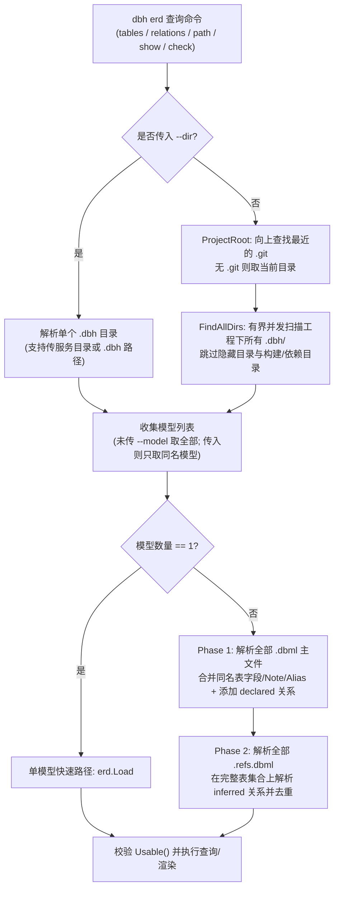

# ERD 多 `.dbh/` 扫描与合并流程

本文档说明 `dbh erd`（简写 `er`）如何在单仓库及多服务（monorepo）工程中定位 `.dbh/` 目录、快速并发扫描并合并关系模型。对应实现见 `internal/erd/model.go` 与 `internal/dbh/erd.go`。

## 整体流程

## 分步说明

### 1. 确定扫描根目录

- **默认模式（未传 `--dir`）**：调用 `erd.ProjectRoot(".")`，从当前工作目录逐级向上查找包含 `.git`（目录或文件）的最近祖先目录作为工程根；如果不在任何 Git 仓库内，则以当前目录本身作为扫描根，不会越界扫描上级目录。
- **限定目录模式（传入 `--dir PATH`）**：跳过全工程扫描，只读取指定路径：
  - 若 `PATH` 本身名为 `.dbh`，直接使用该目录；
  - 否则优先检查 `PATH/.dbh` 是否存在，存在则使用 `PATH/.dbh`，不存在则尝试直接使用 `PATH`。

### 2. 并发扫描与剪枝（`FindAllDirs`）

为保证在大型 monorepo 中仍保持毫秒级响应，`FindAllDirs` 采用以下策略：

1. **只读目录项（零文件 `stat`）**：基于 `os.ReadDir` 遍历目录项，直接通过 `entry.IsDir()` 识别子目录，不对其中的普通文件执行额外 `stat`，也不跟随符号链接目录。
2. **目录剪枝**：
   - 命中 `.dbh` 后立即记录路径，不再递归进入 `.dbh` 内部；
   - 跳过所有其他隐藏目录（名称以 `.` 开头，如 `.git`、`.cache`、`.next`、`.gradle`、`.venv`、`.idea`、`.vscode`）；
   - 跳过常见依赖、构建与产物目录：`node_modules`、`vendor`、`target`、`dist`、`build`、`out`、`bin`、`obj`、`logs`、`tmp`、`coverage`、`__pycache__`、`Pods`、`DerivedData`、`third_party`、`testdata`。
3. **有界并发防死锁**：使用容量为 `min(NumCPU, 8)` 的信号量 channel 限制并发 goroutine 数量；当并发槽位已满时，当前协程直接同步递归扫描子目录，避免等待自身释放槽位造成死锁。
4. **稳定顺序**：并发扫描结束后对 `.dbh` 绝对路径排序，确保后续加载与输出顺序确定。

### 3. 模型筛选与两阶段合并（`LoadAll`）

扫描到所有 `.dbh/` 后，按以下规则加载模型：

- **模型筛选**：
  - 未传 `--model`：调用 `erd.List(dir)` 收集每个 `.dbh/` 下所有合法的 `<name>.dbml`；
  - 显式传 `--model M`：只在各 `.dbh/` 中查找 `<M>.dbml`。
- **单模型快速路径**：仅命中 1 个模型时直接走 `erd.Load(dir, name)`，与单目录单模型行为完全一致。
- **多模型两阶段合并**：
  1. **Phase 1（表与 `declared` 关系）**：先解析所有 `<model>.dbml`，将表合并到同一个 `Model` 中，再添加所有主文件中的 `declared` 外键关系。
     - **同名表合并**：若多个 `.dbh/` 定义了相同展示名（`table` 或 `schema.table`）的表，按列名去重追加缺失字段，并在原表为空时补充 `Alias` 与 `Note`。
  2. **Phase 2（`inferred` 关系）**：等全部表加载完成后，再解析所有 `<model>.refs.dbml`。因此，某服务 `.refs.dbml` 中指向另一服务 `.dbh/` 内表的跨目录关联同样能正确解析，并参与 `relations`、`show` 与 `path` 寻路。
  3. **去重与校验**：
     - 关系以标准化端点与字段集合去重；若某条 `inferred` 关系已在任一 `.dbh/` 的主文件中声明为 `declared`，则发出 `already declared` 警告并保留 `declared`。
     - `Model.Usable()` 记录全部已加载的 `.refs.dbml` 路径：主文件语法错误或 `.refs.dbml` 含非 `Ref` 声明时直接报错；仅失效的 `inferred` 关系在查询时输出警告并跳过，不阻塞其余结果。

## 各子命令行为对照

| 命令 | 扫描范围 | 合并方式 | `--dir` 作用 | `--model` 默认值 |
|---|---|---|---|---|
| `tables` / `relations` / `path` / `show` / `check` | 默认扫描工程内所有 `.dbh/` | 合并为单一逻辑模型查询/校验 | 限定单个 `.dbh/` | 空（加载全部模型） |
| `status` | 默认扫描工程内所有 `.dbh/` | 不合并，按每个模型文件逐行展示路径与状态 | 限定单个 `.dbh/` | 空（列出全部模型） |
| `pull --save` | 不做全工程扫描 | 只写入当前或向上最近的单个 `.dbh/`（无则在工程根/当前目录创建） | 指定写入目标目录（自动补 `.dbh`） | `schema` |

## 性能参考

`BenchmarkFindAllDirs`（见 `internal/erd/model_test.go`）在模拟 50 个服务 × 20 子目录（共 1,050+ 源码目录）加 200 个 `node_modules` 子目录的 monorepo 上实测耗时约 **2.6 ms/op**，满足高频交互与 Agent 调用的实时性要求。
